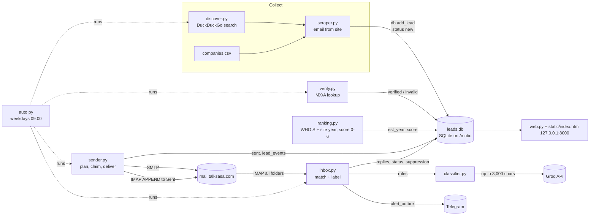

# LeadBot Unified Audit Report

Audit date: 19 Oct 2026. Code at commit `0a67897` on `main`. This audit answers `docs/LeadbotAudit.md`.

## How this audit was done

**What was inspected:** every Python module (`main.py`, `auto.py`, `config.py`, `db.py`, `discover.py`, `scraper.py`, `verify.py`, `ranking.py`, `personalise.py`, `sender.py`, `inbox.py`, `classifier.py`, `notify.py`, `web.py`, `web_extra.py`, `dashboard.py`), the dashboard page `static/index.html`, the templates, `uses.yaml`, `.gitignore`, `.env.example`, `requirements.txt`, all 13 test files, and the git history (12 commits). The previous audits were also inspected: `docs/leadbot-audit.md` and `docs/checkpoint.md`, read from git `HEAD` because they are deleted in the working tree, plus the Claude Doc "LeadBot Trust Audit: Goal 1".

**Evidence collected:**
- Live `.env`: setting names and non-secret values only. Secret values were masked and are not reproduced here.
- `leads.db`: opened in SQLite read-only mode (`mode=ro`); `PRAGMA quick_check` = ok.
- Process list and crontab.
- Watcher logs left by earlier Claude Code sessions.
- Offline probes of pure functions (classifier rules, status rules, header decoding), with sockets blocked.
- Full test suite: **225 passed**. It ran with `DB_PATH` pointed at a non-existent scratch file. That file was never created, which shows no test touched a non-test database. Sockets are blocked by `tests/conftest.py`.

**What was not done:**
- No email was sent.
- No mailbox was read.
- Groq, Telegram, WHOIS, DNS and websites were not contacted.
- GitHub was not contacted.
- No process was started or stopped.
- No database or project file was changed.

The only exception to the last point is this report, which the owner asked for. Probe scripts were kept in a scratch folder outside the repository.

**Changes made earlier on 19 Oct, before this audit started (disclosed for completeness):**
- The dashboard (`uvicorn web:app`) was restarted at about 08:50 EAT. Its import runs `db.init()` and `web.ensure_schema()`.
- The Phase 1 fixes were committed as `0a67897`.
- A Phase 1 section was added to the Claude Doc audit.

**Evidence labels used below:** **Verified** means seen in code and backed by a test, a probe or data. **Code-read** means seen in code but not executed. **Inference** means a reasoned consequence that was not reproduced. **Unknown** means it could not be checked offline.

---

## Section 1: Executive summary

LeadBot is a small, coherent, single-operator system that has had a good week of safety work. Sending is now well guarded:
- one send run at a time (`locks`);
- a per-email claim that rechecks status, suppression, duplicates and the cap inside one write transaction (`db.claim_send`);
- industry approval (`uses.yaml`);
- a bounce-rate gate;
- a dry run that is read-only.

The remaining serious risks are almost all in **reply processing**, which is what the watcher runs.

**Biggest risks (all verified):**
1. **Genuine replies are permanently suppressed as "bounces", silently (A-01, A-02).**
    - A human reply containing "undeliverable", "address not found", "delivery has failed" or "mailbox unavailable" is labelled `bounce` by a keyword rule. The same happens when the AI answers "bounce".
    - The lead is set to *bounced*, its address goes on the suppression list for good, and **no alert is sent**, because `bounce` is not in `ALERT_ON`.
2. **A single malformed message stops all reply processing (A-04).** A subject with an unknown charset raises `LookupError` before the skip decision. Junk mail is now read too, so this is likely sooner or later. The whole check aborts at the same message on every poll. The watcher only prints the error.
3. **Temporary mail-server refusals are treated as permanent bounces (A-03).** Any refused recipient, including a 4xx greylisting code or a 421, is marked *bounced* and suppressed.
4. **The inbox watcher is running, against the stated requirement (A-06).** `main.py watch` (pid 3423) has been running since 02:47 EAT today. It was started from an earlier Claude Code session, and its last heartbeat was at 09:20 EAT. It was not stopped, per the audit rules.
5. **Sending is currently paused by the bounce gate.**
    - 6 of the 68 real companies emailed in the last 14 days bounced (8.8%, limit 3%).
    - Any `main.py send` will stop until enough of those sends age out of the window, from about 25 Oct.
    - That bounce rate, plus 23 of 92 leads (25%) rejected as invalid, is the clearest evidence that **prospect quality (Goal 2) is the business bottleneck**, not sending volume.

**Strongest capabilities:**
- duplicate- and cap-safe sending;
- an opt-out rule set that only acts on plain requests (English, Swahili, Sheng);
- AI failures and unsure answers held for review with one alert each;
- a persistent Telegram alert queue;
- thread matching by Message-ID;
- every mail folder read;
- an event log (`lead_events`);
- an exact copy of every email sent since 12 Oct;
- an offline test suite that blocks the network.

**Highest-value opportunities:**
- Make reply processing fail safe: A-01, A-02 and A-04. These are small changes.
- Put a person in front of each new lead's first email.
- Replace the newness-heavy score with separate fit, growth, contact and evidence ratings.
- Record the timestamps and decisions that Goal 4 needs before more data accumulates.

**Current data, for scale:**
- 92 leads: 62 *sent*, 6 *bounced*, 23 *invalid*, 1 *replied*.
- 0 waiting to be emailed.
- 75 emails sent to 69 leads, 5 of them follow-ups.
- 11 replies stored: 6 bounces, 3 needs-review, 2 out-of-office.
- No interested reply, meeting or client recorded yet.

---

## Section 2: Current architecture and workflow

| # | Stage | Code | State | Automatic or manual |
|---|---|---|---|---|
| 1 | Discovery | `discover.run`, `discover_category`, `consider`; `scraper.run` for CSV | `leads` (`source`, `source_query`, `source_url`, `discovered_at`), event `discovered`, `discovered.csv` | Manual `main.py discover` / `scrape`, or `auto` daily |
| 2 | Verification | `verify.run` / `domain_ok` (MX, then A record) | `leads.status` new to verified/invalid, events | Manual or `auto` |
| 3 | Scoring | `ranking.fill_years`, `estimate`, `score_reasons`, `save_scores`, `waiting` | `est_year`, `est_year_source`, `score`, `score_reasons` (overwritten) | Run inside `sender.plan` before a real send |
| 4 | Message generation | `sender.load_template`, `fill`, `compose`; `personalise.*` only if `USE_AI_OPENER=true` (it is `false`) | `templates/<industry>.txt`, `uses.yaml` | Automatic at send |
| 5 | Scheduling and limits | `sender.plan` (follow-ups first, then waiting leads), `bounce_gate`, `db.claim_send`, `db.acquire_lock` | `send_claims`, `locks` | `main.py send` or `auto` at 09:00 |
| 6 | Sending and errors | `sender._send_batch`, `send_one`, `deliver`, `_not_sent`, `save_to_sent` | `sent` (date, subject, body, Message-ID), events `email_sent` / `send_failed` / `send_skipped` | Automatic within a run |
| 7 | Inbox polling | `inbox.check_once`, `mail_folders`, `check_message` | `replies.imap_uid` (folder:UID), `skipped`, `last_check.txt` | `main.py watch`, `inbox`, or `auto` every 5 min |
| 8 | Matching | `db.find_lead_by_email`, `thread_lead` (In-Reply-To/References), `colleague_leads` (same domain), `answers_our_email` | `replies.lead_id` | Automatic |
| 9 | Classification | `classifier.quick_rules`, `opt_out`, `classify` (Groq, 3 tries, confidence ≥ 0.6) | `replies.label`, `summary` | Automatic |
| 10 | Follow-ups | `sender.followups_due`, `build_followup` (same thread, one per lead, after 5 business days) | `sent` (second row) | Inside send runs; `FOLLOWUPS_APPROVED=true` |
| 11 | Alerts and review | `db.queue_alert`, `inbox.send_alerts`, `notify.alert_text` | `alert_outbox` | Automatic for interested, question, needs_review |
| 12 | Dashboard | `web.all_data`, `set_status`, `set_handled`, `web_extra.*` | Reads all tables; writes `leads.status`, `replies.handled` | Manual |

**Hidden dependencies and unclear ownership:**
- `web.py` runs `db.init()` and adds a `replies.handled` column when it is imported. Starting the dashboard migrates the live database.
- Migrations are ad-hoc `ALTER TABLE` statements in `db.init`, with `user_version` at 0.
- `inbox.mail_folders` imports a private parser from `sender` (`_folders`).
- `ranking.FREE_MAIL` is reused by `inbox.colleague_leads`.
- There are two dashboards (`dashboard.py` with Streamlit, and `web.py`), plus duplicate `/api/leads/{id}/emails` routes in `web.py` and `web_extra.py`. The router included first wins.
- None of this justifies a rewrite.

---

## Section 3: Goal scorecard

**Rubric:**
- **Ready:** the goal's requirements are met in code, covered by tests, and backed by data.
- **Partly ready:** the core mechanisms exist; the open gaps are medium or lower, or are confined to one path.
- **Not ready:** an open critical or high gap, or the data the goal needs is not recorded.

| Goal | Rating | Basis |
|---|---|---|
| 1. Trustworthiness and safety | **Sending: Partly ready. Reply processing: Not ready** | Sending is guarded by lock, claims, suppression recheck and the bounce gate, and covered by tests. Open gaps are A-03 (temporary refusals as bounces), A-09 (the cap can be overridden) and A-10 (UTC date). Reply processing has A-01, A-02, A-04 and A-05 open, all silent failures. |
| 2. Prospect quality | **Not ready** | The score uses three signals (0–6 points); newness, mostly WHOIS domain age, outweighs service fit (A-18). Industry is just the search category (A-17). There is no evidence or confidence field. Outcomes so far: 8.8% bounce, 25% invalid. |
| 3. Sales workflow | **Partly ready** | Statuses `meeting` and `client` are timestamped, replies can be marked handled, and the email history shows per lead. Missing: a next-action view, a follow-ups-due list, AI label correction with history, reasons for closing, and a proposed-versus-booked meeting split. |
| 4. Evidence-based improvement | **Not ready** | Template and source are recorded. Not recorded: send time, true receipt time, score at send, label corrections, disqualification reasons. No positive outcome yet, so there is no baseline. |

---

## Section 4: Verified findings register

Severity reflects business impact if left as is. Confidence reflects the strength of the evidence.

### 4a. Defects

| ID | Sev. | Conf. | Goal | Finding | Evidence | Business impact | Recommended action | Regression test |
|---|---|---|---|---|---|---|---|---|
| A-01 | Critical | High | 1, 3 | A human reply containing a bounce phrase is labelled `bounce`, the lead is bounced and suppressed, and no alert is sent | `classifier.BOUNCE_WORDS` / `quick_rules` (applied to every reply sent to `classify`); `inbox.status_after` sets *bounced*; `db.set_status` calls `_suppress`; `inbox.ALERT_ON` lacks `bounce`. **Probe:** "Your first email to our old address was undeliverable, please use this one. We would like pricing." returns `bounce` | An interested buyer is lost permanently and never seen | Decide `bounce` only on the DSN path (`is_bounce` or `multipart/report`). In `classify`, a bounce phrase in a person's reply becomes `needs_review` | Feed that reply through `check_message`: lead stays *sent*, not suppressed, one alert |
| A-02 | High | High | 1 | The AI alone can suppress a lead by answering `bounce`. AI `not_interested` and `out_of_office` are never alerted | `classifier.classify` returns any label in `LABELS` with confidence ≥ 0.6 except `unsubscribe`. **Probe:** a fake AI answer `bounce`/0.7 is returned and not alerted | A misread interested reply is silently closed or suppressed | Treat AI `bounce` like AI `unsubscribe` (hold and alert). Send a low-priority daily digest of `not_interested` and `out_of_office` labels | Fake AI says bounce: lead unchanged, needs_review, one alert |
| A-03 | High | High | 1, 2 | Any refused recipient, including 4xx or 421, becomes a permanent bounce | `sender._not_sent`: `SMTPRecipientsRefused` sets *bounced* and suppresses. Python's `smtplib.SMTP.sendmail` raises it for any RCPT code other than 250/251 (checked in the installed source) | Greylisting or a busy server permanently removes good prospects and inflates the bounce rate, which pauses sending | Read `e.recipients[addr][0]`: 5xx (ideally 5.1.x) means bounced; 4xx and 421 mean failed (retry later, counted against A-13) | Fake SMTP raising `SMTPRecipientsRefused({to: (450, …)})`: lead stays verified, `send_failed` logged |
| A-04 | High | High | 1 | One malformed message aborts every inbox check, permanently | `inbox.check_message` calls `make_header(decode_header(Subject))` for every message before deciding to skip it. **Probe:** an `=?x-bogus-charset?…?=` subject raises `LookupError`. `check_once` has no per-message guard, so `add_skipped` and the heartbeat never run. `watch` only prints | All replies and opt-outs stop being processed. The dashboard shows amber after 20 minutes and red after 24 hours | Wrap each message: on error, store its key in a quarantine/`skipped` list with the error, queue one alert, continue. Decode headers safely | Fake folder with a bogus-charset message plus a real reply: the reply is stored, one alert for the bad one, heartbeat written |
| A-05 | High | High | 1 | Watcher failures are invisible except on the dashboard | `inbox.watch` catches every exception and prints it. Watcher log from 17 Oct shows "Inbox check failed: [Errno -3] Temporary failure in name resolution". There is no stale-heartbeat alert | Replies wait unseen for days | Alert after N consecutive failures or a failed login; a separate stale-heartbeat check (cron or Task Scheduler) that alerts | Fake IMAP login failure 3 times: one alert; heartbeat older than 30 minutes: one alert |
| A-08 | Medium | High (code) / Medium (impact) | 2 | A DNS outage during `verify` marks leads invalid for good | `verify.domain_ok`: any exception on MX and then A gives `False`, and `run` sets *invalid*. DNS outages were observed on this laptop on 17 Oct | Good leads discarded during network trouble (23 of 92 are invalid; how many for this reason is unknown) | Only NXDOMAIN or NoAnswer count as invalid; timeouts and resolver errors leave the lead *new* | Resolver raising `Timeout`: lead stays *new* |
| A-09 | Medium | High | 1 | The 10-email cap is a setting, not a ceiling | `.env DAILY_LIMIT=10`, but the default is 25 in `config.py` and `.env.example`. `sent` per day: 11 Oct 10, **12 Oct 23**, 13 Oct 8, **16 Oct 12**, **17 Oct 22**. 17 Oct was an owner-approved override; 12 and 16 Oct cannot be explained from local evidence | A missing `.env` line or a one-off override exceeds the agreed volume | Hard maximum of 10 in code; a higher value requires an explicit flag and logs an `override` event; default 10 | `DAILY_LIMIT=25` without the flag: at most 10 sent |
| A-10 | Medium | High (code) | 1, 4 | Day boundary mismatch between UTC and local time | `sent.sent_on DEFAULT (date('now'))` is UTC; `db.sent_today` and `claim_send` use `date.today()` (local EAT) | Sends between 00:00 and 03:00 EAT count against the wrong day; daily charts shift | Store `sent_at` as UTC datetime; count the cap by Nairobi date in one place | Clock at 01:00 EAT: cap counts today's sends |
| A-11 | Medium | High | 1 | Domain-level suppression is stored but never enforced | `suppression.domain` is written, but `add_lead`, `claim_send` and `waiting` check the exact email only. A colleague's opt-out marks only existing leads on that domain (`inbox.check_message`) | A company that opted out can be re-added under another address and emailed | For opt-outs from a company domain (not free mail), suppress the domain in `add_lead` and `claim_send` | Opt-out from info@x.co.ke, then add sales@x.co.ke: refused |
| A-12 | Medium | Medium | 1, 2 | Bounces are recognised only from `mailer-daemon@` or `postmaster@` | `inbox.BOUNCE_SENDERS` | DSNs from other senders are skipped; dead addresses stay *sent* and get follow-ups | Also detect `Content-Type: multipart/report; report-type=delivery-status` | A DSN from bounces@provider is recorded |
| A-13 | Medium | Medium | 1, 2 | Failed leads are retried forever. Three failures in a row stop the batch, and ranking order is fixed, so the same failing leads can block a day | `sender._failed` leaves the lead *verified*; `MAX_FAILURES_IN_A_ROW = 3`; `ranking.waiting` sorts by score then id. The blocking part is inference: no `send_failed` events exist yet | Wasted attempts; possibly no sends at all | Stop after 3 failed attempts per lead (from `send_failed` events); move failed leads to the back of the order | A lead failing 3 times is not planned again |
| A-14 | Medium | Medium | 1 | IMAP UIDVALIDITY is not tracked | No `UIDVALIDITY` anywhere in the code; `replies.imap_uid` and `skipped` are keyed by folder:UID | After a mailbox rebuild, new mail with reused UIDs is treated as already seen | Store UIDVALIDITY per folder; on change, re-key by Message-ID | Fake folder with a changed UIDVALIDITY: new mail processed |
| A-15 | Medium | High | 4, 3 | Send and reply times are incomplete | `sent` has a date only; `replies.received_at` is processing time (`CURRENT_TIMESTAMP`), not the `Date:` header; 30 of 75 sends have no stored body (sent before 12 Oct) | Time-to-reply cannot be measured; dates shift during outages | Add `sent_at` (UTC) and `received_at` from `Date:`, keeping `processed_at`; mark old rows unknown | New send and reply rows carry both times |
| A-16 | Medium | High (code) | 1 | `auto` skips a day if it is not running during the 09:00 hour | `auto.daily_due`: `now.hour != RUN_HOUR` returns `False` (F10, still present). `.auto_last_run` does not exist, so `auto` has never run its daily job | A sleeping laptop silently skips the day | Run if not done today and the time is after 09:00 on a weekday | Start at 11:00 on a weekday: runs once |
| A-17 | Medium | High | 2, 1 | A lead's industry is the search category, never checked, and it picks the template and the approval | `discover.consider` passes `category` straight to `db.add_lead`. `auto.daily_run` does discover, verify and send in one go with no human review | A hotel found by a "church" search gets the church template, possibly the same morning | New leads wait for a person to confirm industry and fit before their first email (a review state) | A discovered lead is not planned until it is confirmed |
| A-18 | Medium | High | 2 | Newness outweighs fit; "new" is mostly domain age | `ranking.score_reasons`: ≤ 3 years old scores 3, busy niche 2, own domain 1, unknown year 0. `est_year` sources among 92 leads: WHOIS 23, site 11, unknown 4, never tried 54 | An irrelevant new domain (4 points) outranks an established SACCO (3); WHOIS dates a domain, not an organisation | Section 6: separate dimensions; WHOIS as weak evidence only | Fixture: irrelevant new org ranks below a relevant established one |
| A-19 | Medium | Medium | 1 | Database safety | `leads.db` is on `/mnt/c` (9p mount), `journal_mode=delete`, `user_version` 0, ad-hoc migrations at import (`db.init`, `web.ensure_schema`). 10 manual backups sit beside it; no restore test. The `locks` and claims protection was tested on Linux `/tmp`, not on 9p | Locking errors or corruption under the watcher, dashboard and send process together; no proven recovery | Previous plan G-13: verified backup, restore test, move to the Linux filesystem, WAL, numbered migrations | Concurrent-write test on the new path; restore drill |
| A-20 | Medium | High (files) / Unknown (visibility) | 1 | Personal data in tracked files | Real lead addresses appear in 9 tracked test files (matched against `leads.db`), and the owner's personal Gmail address is in `tests/test_unlinked_replies.py`. No secret in git history (pattern scan: 0 hits; `.env` and `*.db` never committed). Remote is `github.com/Fndemi/AgentBot`; the earlier audit found it public, which was not re-checked offline | Prospect contact data published with internal findings | Replace with `example.*` addresses; confirm the repo is private | No address from `leads.db` in any tracked file (scripted check) |

### 4b. Design concerns and policy questions (not defects)

| ID | Sev. | Goal | Concern | Evidence | Recommendation |
|---|---|---|---|---|---|
| A-06 | High | 1 | The inbox watcher is running although the requirement says it should be paused | pid 3423 `main.py watch`, started 19 Oct 02:47 EAT; heartbeat 09:20 EAT. It is enabled only by running `main.py watch`, `main.py inbox` or `main.py auto`; there is no crontab and no service. It runs the Phase 1 code (started after the 17 Oct changes) | Owner decision (Section 10). Recommended: stop it until A-01, A-02 and A-04 are fixed |
| A-07 | High | 2, 1 | Sending is paused by the bounce gate | 6 of 68 companies bounced in the 14-day window (8.8% against a 3% limit, minimum 20 sends). 0 verified leads waiting; 39 leads will become due a follow-up | Do not raise the limit. Review where the 6 bounced addresses came from (Section 6) |
| A-21 | Medium | 1 | Data sent to third parties | Groq receives the subject plus up to 3,000 characters of the reply (signatures included). Telegram receives the sender address, subject and a 400-character snippet. Groq is the approved provider; `config.py` and `.env.example` default to `ollama` | Keep Groq (approved); strip signatures and phone numbers before sending; set the default to an explicit value |
| A-22 | Low | 1 | One alert that Telegram always rejects blocks the whole queue | `inbox.send_alerts` stops at the first failure; there is no alert about failing alerts (inference) | Skip an alert after N attempts and show it on the dashboard |
| A-23 | Low | 3, 1 | Dashboard gaps | No login (bound to 127.0.0.1); can set any status; no label correction; no follow-ups-due, send-failure, paused-sending or suppression view; `MAX_STEPS = 3` though the bot sends at most 2 | Section 7 |
| A-24 | Low (legal: unknown) | 1 | Direct-marketing safeguards | Footer has an opt-out line and a `List-Unsubscribe` mailto header, but no postal address or privacy notice. Mail goes from `florence@talksasa.co.ke` via the main mail server, although the README checklist calls for a separate outreach domain. 7 of the emailed leads are free-mail (likely personal) addresses | Owner and legal decisions (Section 10) |
| A-25 | Low | 1 | Dependencies are unpinned | `requirements.txt` has no versions | Pin versions after the next green test run |
| A-26 | Low | 2 | Approval and discovery are out of step | `hr_payroll` is approved but has no `discover` category. 19 emails went to industries not approved today (chama, college, health, insurance, microfinance, transport), all on 11–13 Oct, before approval gating | Align `uses.yaml` and `discover.QUERIES` |
| A-27 | Low | 4 | Test-lead history | Manual test lead 38 got 3 first emails on 12 Oct, before the current guards. It counts toward that day's cap but is excluded from stats (`db.real`) | None; noted so the history is read correctly |

**Classifier confidence** is the model's own number. It has never been calibrated against labelled replies, so the 0.6 threshold is arbitrary. This is Inference: a design concern, not a defect.

---

## Section 5: Previous-audit reconciliation

| Earlier ID | Issue | Status now | Evidence |
|---|---|---|---|
| F1, F2 | Footer quoted back read as unsubscribe | **Verified fixed** | `inbox.OUR_FOOTER`, `QUOTE_START`, `HTML_QUOTE_START`; tests pass |
| G-01 | Broad unsubscribe matching | **Verified fixed** | `classifier.opt_out` / `_direct_request`; probes: questions and disclaimers go to needs_review, plain requests (EN, SW, Sheng) to unsubscribe |
| F3 | "On leave, but we'd like a demo" read as OOO | **Verified fixed** | Out-of-office comes only from headers or subject (`inbox.is_auto_reply`). New gap: the AI can still label it OOO without an alert (A-02) |
| F4 | Unread-only processing | **Verified fixed** | `check_once` searches `SINCE` the first send, read and unread |
| F5, G-10 | Colleagues, Junk and other folders ignored | **Partly fixed** | All folders except Sent and Drafts are read. Colleague mail is held if it answers our email or mentions opting out; other colleague mail is still skipped |
| F6 | Lost Telegram alerts | **Verified fixed** | `alert_outbox`; 3 alerts, all sent. Residual risk A-22 |
| F7 | One SMTP error stops the batch | **Verified fixed** | `send_one` / `_not_sent`. New gap: temporary refusals become bounces (A-03) |
| F8, F9 | Status regression; OOO sets replied | **Verified fixed** for replies | `inbox.status_after`. The dashboard can still set any status |
| G-02 | No alert on AI failure or low confidence | **Verified fixed** | `classify` / `review`, `ALERT_ON` includes needs_review. Gap A-02 for AI `bounce` |
| G-03 | Concurrent sends, cap | **Fixed; not verifiable on the live path** | Lock and claims tested on Linux `/tmp`; live database on 9p (A-19). Cap overridable (A-09) |
| G-04 | Suppression checked right before sending | **Verified fixed** | `db.claim_send` rechecks suppression and status inside `BEGIN IMMEDIATE` |
| G-05 | Watcher supervision and heartbeat alerts | **Verified still present** | A-05 |
| G-06 | Reply text goes to Groq | **No longer a defect: Groq is now the approved provider** | `AI_PROVIDER=groq`, `GROQ_MODEL=openai/gpt-oss-20b`; data minimisation still advised (A-21) |
| G-07 | Incomplete history and timestamps | **Partly fixed** | Bodies kept since 12 Oct, `send_skipped`/`send_failed` events added; times still missing (A-15) |
| G-08 | Public repo, personal data | **Verified still present (files); visibility unknown** | A-20 |
| G-09 | UIDVALIDITY | **Verified still present** | A-14 |
| G-11 | Domain suppression, bounce detection | **Verified still present** | A-11, A-12 |
| F11 | DSNs from other senders | **Verified still present** | A-12 |
| F12 | UTC date and cap | **Verified still present** | A-10 |
| G-12, F13 | Dry-run side effects | **Verified fixed** | `sender.plan(dry_run=True)` skips `fill_years` and `personalise`; `tests/test_dry_run.py` compares a full database dump |
| G-13 | SQLite on the 9p mount, backups | **Verified still present** | A-19 |
| G-14 | Footer address, privacy notice, main domain | **Still present; legal questions unanswered** | A-24 |
| G-15 | Endless retries; follow-ups crowd out new leads | **Verified still present** | A-13; `plan` gives follow-ups first claim on the cap |
| F10 | `auto` skips the day if not running at 09:00 | **Verified still present** | A-16 |

---

## Section 6: Lead quality and scoring recommendations

**What exists today:**
- industry (= search category);
- source, query and URL;
- a site-mentions-Kenya or `.ke` check;
- skips for banks, ISPs, competitors and directories;
- one email per site (prefers info@, sales@ and similar);
- MX/A check;
- start year (site text or WHOIS);
- own-domain versus free-mail email.

The score is one number from 0 to 6 with stored reasons (`score_reasons`), but those reasons are overwritten on every recalculation.

**Rate four separate dimensions and keep them separate.** Store each with its evidence and the date it was collected.

| Dimension | Question | Signals collected now | Missing signals | New data source needed? |
|---|---|---|---|---|
| Service fit | Would they plausibly send bulk SMS or use an SMS API? | Search category; `uses.yaml` uses per industry | Site evidence of members, students, patients, loans, payments, bookings, an app or a sign-up form; a stated customer count; branches | No: from the site text the scraper already fetches (`scraper.site_pages`) |
| Growth/newness evidence | Is there credible evidence they are new or growing? | Site "founded/since/est." year; copyright range; WHOIS domain year | Hiring pages, new branches, recent news or funding, launch date on the site | Mostly the same site text; news needs a new source (later) |
| Contact quality | Will the email reach someone who can decide? | Own domain vs free mail; generic-inbox preference; MX/A | Role of the address (info@ vs a named manager); a bounce or reply history per domain | No |
| Evidence confidence | How complete and recent is the above? | `source_url`, `discovered_at` | Per-signal source and date; conflicts (site year vs WHOIS) | No |

**How to avoid favouring "new" organisations:**
1. **Fit is a gate, not a points bonus.** Only leads with fit rated plausible or strong get ranked at all. Newness then orders leads *within* that group and never lifts a poor-fit lead above a good-fit one.
2. **WHOIS counts as weak evidence only.** It dates the domain, not the organisation, and a re-registered or recently moved domain looks "new". A site statement such as "founded in 2023" is stronger. When the site and WHOIS conflict, show both and treat the evidence as low confidence.
3. **Unknown is not zero.** Store "no evidence" explicitly, so a lead with unknown age is not ranked as if it were old.
4. **A person confirms industry and fit** before the first email (A-17). At 10 emails a day this is a few minutes of work, and it is the cheapest quality control available.
5. **Learn from outcomes.** Only once there are enough results (Section 8), check whether the dimensions predict replies before changing any weights.

**Wasted effort today:**
- 25% of leads are rejected as invalid.
- 8.8% of emailed companies bounced.
- 7 emailed addresses are free mail.

Look at the sources (`source_query`) of the 6 bounced and 23 invalid leads before running discovery again. This is a short read-only query, and its result tells you which queries to drop.

---

## Section 7: Sales workflow and dashboard recommendations

**Minimum daily routine, about 15 minutes:**
1. **Health check:** is the inbox watcher fresh, are there failed checks, is sending paused, and are any send claims left over?
2. **Replies needing a person:** interested, then questions, then needs-review, oldest first. Mark each handled or set *meeting*.
3. **Opportunities:** leads at *meeting*, with the next step and its date.
4. **Today's sends:** the planned batch (follow-ups and first emails) and its count against 10. New leads await confirmation (A-17).
5. **Close the loop:** record meetings held, clients won, and why leads were lost.

**The model can stay status-based.** Add only what the routine needs:
- **`next_action` and `next_action_due`** on the lead, set by the reply handler and the dashboard.
- **A reason when closing** (not interested, wrong fit, no budget, has a provider).
- **Meeting proposed versus held:** keep the `meeting` status and add `meeting_held_at`.
- **Label correction with history:** a `reply_labels` table (reply, old label, new label, who, when) rather than overwriting `replies.label`.

The remaining stages in the brief, such as qualified, ready to contact or negotiation, can be derived from these fields plus the review state of new leads. There is no need for a dozen statuses.

**Dashboard, highest value first:**
1. **System health strip:** watcher heartbeat (exists), last failed check and its error, bounce-gate state, last send run with its sent, failed and skipped counts, and leftover claims. This answers "is nothing happening because there's no work, or because something broke?"
2. **Needs attention:** exists as "Needs your reply". Add follow-ups due and new leads awaiting confirmation.
3. **Label correction** on the reply drawer.
4. **Funnel by cohort** (Section 8) instead of 30-day vanity counts.
5. **Score reasons** on the lead drawer once Section 6 exists.

Do not redesign the page; these are additions to existing views.

---

## Section 8: Analytics and measurement plan

**Unit:** a lead's first email. **Cohort:** the ISO week of the first email. The cohort and its counts stay fixed once the window closes.

| Metric | Numerator | Denominator | Source data | Window |
|---|---|---|---|---|
| **Primary: positive reply rate** | Leads in the cohort with a reply a person confirmed as interested | First emails delivered (sent minus hard bounces) | `sent`, `replies` and confirmed labels (needs label correction, Section 7) | 21 days after the first email |
| **Primary: meeting rate** | Leads reaching *meeting* | First emails delivered | `leads.meeting_at`, `sent` | 45 days |
| **Primary: client rate** | Leads reaching *client* | First emails delivered | `leads.client_at` | 90 days |
| **Guardrail: hard bounce rate** | Leads hard-bounced (5xx or DSN) | Companies emailed | `lead_events` bounced (after A-03) | 14 days, rolling |
| **Guardrail: opt-out rate** | Leads unsubscribed | First emails delivered | `lead_events` unsubscribed | 21 days |
| Diagnostic: verified contact rate | Verified | Verified + invalid | Statuses by `source_query` | Per discovery run |
| Diagnostic: any human reply rate | Leads with a non-automatic, non-bounce reply | Delivered | `replies` | 21 days |
| Diagnostic: follow-up lift | Positive replies received after the follow-up | Leads sent a follow-up | `sent` step 2, `replies.received_at` (needs A-15) | 14 days after the follow-up |
| Diagnostic: time to first reply | Median hours from `sent_at` to `received_at` | Leads that replied | Needs A-15 | Per cohort |
| Diagnostic: AI correction rate | Replies whose label a person changed | Replies labelled by the AI | `reply_labels` (Section 7) | Monthly |
| Diagnostic: rates by segment | Each primary rate | Same, split by industry, `source_query`, template, fit rating | `leads`, `sent.template`, events | Per cohort month |

**Avoiding misleading comparisons:**
- Always show raw counts beside rates, for example "2 of 40", never "5%" alone.
- Don't compare segments with fewer than about 30 delivered first emails or fewer than 5 outcome events. Say "too few to tell".
- Compare cohorts only after their window has closed. A two-day-old cohort always looks worse.
- Hold volume steady at 10 a day while comparing. When volume, lead quality or the template changes, start a new baseline rather than mixing.
- Lead quality differs by industry, so compare templates within an industry.

**Baseline:** the first 4 full weeks of sending after the A-15 timestamps exist. That is about 200 first emails at 10 a day, possibly fewer while follow-ups take part of the cap. Then compare month against month, by cohort. Expect only a handful of positive replies per month at this volume. Decisions should rest on several months, or on large differences only.

**Current data:** no interested reply, meeting or client yet. **There is no baseline to report.**

---

## Section 9: Prioritized implementation roadmap

Effort: **S** is under half a day, **M** is 1–2 days, **L** is more.

### Phase 0: Immediate safeguards

| # | Task | Priority | Benefit | Depends on | Effort | Tests and completion criteria |
|---|---|---|---|---|---|---|
| 0.1 | Bounce label only from delivery reports; AI or keyword bounce in a person's reply goes to needs_review (A-01, A-02) | 1 | No silent loss of buyers | None | S | Probes from A-01 and A-02: lead unchanged, one alert. Existing bounce tests still pass |
| 0.2 | Isolate each message in `check_once`; safe header decoding; quarantine plus alert (A-04) | 1 | Processing never stops on one email | None | S | Bogus-charset fixture: the other replies are processed, heartbeat written, one alert |
| 0.3 | 4xx and 421 RCPT refusals are failures, not bounces (A-03) | 2 | Good leads kept; bounce gate accurate | None | S | 450 refusal: lead *verified*, `send_failed`; 550: *bounced* |
| 0.4 | Watcher failure alerts and a stale-heartbeat check (A-05) | 2 | You know within 30 minutes when processing stops | 0.2 | S–M | 3 failed checks: one alert; heartbeat older than 30 minutes: one alert; no duplicates |
| 0.5 | Hard daily ceiling of 10; logged override; default 10 (A-09) | 3 | The agreed volume cannot drift | None | S | `DAILY_LIMIT=25`: at most 10 sent; override logged |
| 0.6 | DNS errors don't invalidate leads (A-08) | 3 | No leads lost to outages | None | S | Timeout fixture: lead stays *new* |

0.1, 0.2, 0.3, 0.5 and 0.6 are independent of one another. 0.4 builds on 0.2.

### Phase 1: Data integrity and reliability

| # | Task | Benefit | Depends on | Effort | Completion criteria |
|---|---|---|---|---|---|
| 1.1 | Verified backup, restore test, move `leads.db` to the Linux filesystem, WAL, numbered migrations (`user_version`); stop the dashboard from migrating on import (A-19) | Safe concurrency and recovery | Owner approval; watcher stopped during the move | M | Restore drill passes; concurrent-write test passes on the new path |
| 1.2 | `sent_at` UTC, `received_at` from `Date:`, `processed_at`; one Nairobi-date cap rule (A-10, A-15) | Correct day counts and timings | 1.1 | S–M | New rows carry all three; 01:00 EAT test passes |
| 1.3 | Domain suppression for company opt-outs; DSN detection by `multipart/report` (A-11, A-12) | No re-contact after opt-out; bounces caught | 0.1 | S | Tests from A-11 and A-12 |
| 1.4 | Retry cap of 3 failures per lead; failed leads move to the back (A-13) | No wasted or blocked days | 0.3 | S | Lead failing 3 times is not planned again |
| 1.5 | UIDVALIDITY per folder (A-14) | No missed mail after a mailbox rebuild | 1.1 | S–M | Changed-UIDVALIDITY fixture is processed |
| 1.6 | `auto` catches up a missed weekday run (A-16) | No silent skipped days | None | S | Start at 11:00: runs once |
| 1.7 | Alert queue skips an alert that keeps failing and shows it (A-22) | One bad alert can't block the others | None | S | The failing alert is skipped after N attempts and the others are delivered |

### Phase 2: Prospect quality

| # | Task | Benefit | Depends on | Effort | Completion criteria |
|---|---|---|---|---|---|
| 2.1 | Review state for new leads; nothing is emailed until a person confirms industry and fit (A-17) | Wrong-fit emails stop | 1.1 | S–M | A discovered lead is never planned before confirmation |
| 2.2 | Four rating fields with per-signal evidence and date; fit gates, newness orders within fit; WHOIS is weak evidence (A-18) | Explainable ranking that doesn't over-rate "new" | 2.1 | M | Fixture ranking test; reasons shown per lead |
| 2.3 | Snapshot the ratings on each `email_sent` event | Later analysis by rating | 2.2, 1.2 | S | Event detail carries the ratings |
| 2.4 | Review the sources of the 6 bounced and 23 invalid leads; prune queries; align `uses.yaml` and `QUERIES` (A-26) | Fewer wasted leads | None | S | A list of queries kept or dropped, with counts |

### Phase 3: Sales workflow

| # | Task | Benefit | Depends on | Effort | Completion criteria |
|---|---|---|---|---|---|
| 3.1 | `next_action` / `next_action_due`; follow-ups-due and new-leads-to-confirm lists on the dashboard | A daily to-do list | 2.1 | M | Every open lead shows its next action |
| 3.2 | Label correction with a `reply_labels` history | Fix AI mistakes without losing the record | None | S–M | A correction keeps the old label, who changed it and when |
| 3.3 | Close reasons; `meeting_held_at` | Lost-deal and meeting analysis | None | S | Closing requires a reason |
| 3.4 | Split the cap between follow-ups and new leads (G-15) | New leads keep flowing | Owner decision | S | The split is respected in `plan` |

### Phase 4: Analytics and optimisation

| # | Task | Benefit | Depends on | Effort | Completion criteria |
|---|---|---|---|---|---|
| 4.1 | Cohort funnel queries and a dashboard view (Section 8) | Honest measurement | 1.2, 3.2, 3.3 | M | The view shows counts and rates per cohort with the small-sample rule |
| 4.2 | Baseline report after 4 weeks of complete data | Starting point for comparison | 4.1 | S | Report filed with counts |

### Phase 5: Optional, only if the evidence supports it

- **Ollama:** compare it against Groq on 50 or more real, person-labelled replies. Adopt it only if accuracy is comparable and the laptop copes: a 7B model needs about 16 GB RAM, slows the machine, and needs its own supervision. Groq is approved, and the privacy gain can mostly be had by trimming what is sent (A-21).
- **Dashboard rework and a richer CRM:** only after Phase 3 shows what is used.

---

## Section 10: Owner decisions

| Decision | Recommended default |
|---|---|
| Keep the inbox watcher (pid 3423) running? | **Stop it** until 0.1 and 0.2 are done (about a day of work). Meanwhile read the mailbox by hand once a day. Sending is paused anyway, so delayed opt-out processing cannot cause a send |
| Respond to the bounce gate pause? | Leave the 3% limit. Let sends age out from about 25 Oct; do task 2.4 first |
| Daily cap override policy | No overrides above 10 without a recorded reason (task 0.5) |
| New-lead review before the first email | Yes (task 2.1) |
| Follow-up versus new-lead split of the 10 | At most 5 follow-ups a day; the rest for new leads |
| Free-mail (personal) addresses | Don't email them unless the lead is a sole trader you confirmed |
| Separate outreach domain | Yes, before volume grows (the README checklist already says so) |
| Footer postal address and privacy notice; ODPC registration; lawful basis for B2B email in Kenya | Get qualified legal advice; add the address and a privacy link meanwhile |
| Data retention | Keep reply bodies 12 months, then keep only label and summary. Keep 4 rolling backups outside the project folder. Delete old CSV exports and `previews.txt` after use |
| Repository visibility and test data | Make it private; replace real addresses with `example.*` |
| AI provider | Keep Groq; strip signatures and phone numbers from what is sent; revisit Ollama per Phase 5 |

---

## Section 11: Readiness checklist

**Before automatic inbox processing is resumed:**
- [ ] 0.1 done: no non-DSN reply can set *bounced* or suppress, and the AI's bounce is held
- [ ] 0.2 done: a bad message cannot stop a check
- [ ] 0.4 done: failed checks and a stale heartbeat each send one Telegram alert, tested end to end with a real Telegram message
- [ ] The full test suite passes with the network blocked
- [ ] A backup of `leads.db` exists outside the project folder and has been restored once
- [ ] The watcher runs under something that restarts it (Task Scheduler or a systemd user service), not inside a chat session

**Before outbound automation is expanded (`auto`, or more than 10 a day):**
- [ ] Everything above
- [ ] 0.3, 0.5 and 0.6 done
- [ ] 1.1 and 1.2 done: database on the Linux filesystem with WAL; times recorded
- [ ] 2.1 done: no first email without a confirmed lead
- [ ] Bounce rate under 3% over at least 20 companies
- [ ] Separate outreach domain with SPF, DKIM and DMARC passing
- [ ] Legal questions in Section 10 answered

---

## Final summary

**1. Five highest-priority actions**
1. Stop bounce labels from coming from anything but delivery reports (task 0.1, A-01, A-02).
2. Make one bad message unable to stop the inbox check (task 0.2, A-04).
3. Decide on the running watcher; recommended: stop it until 1 and 2 are done (A-06).
4. Treat temporary SMTP refusals as failures, not bounces (task 0.3, A-03).
5. Alert on watcher failures and a stale heartbeat (task 0.4, A-05).

**2. Three things not to build yet**
1. A move to Ollama. Groq is approved; measure first (Phase 5).
2. New lead sources or enrichment services. First fix the review gate and scoring, and prune the queries that produced the bounces.
3. Analytics dashboards or experiments. The timestamps and confirmed labels they need don't exist yet, and there are no positive outcomes to measure.

**3. Single best next task:** **task 0.1, "No reply is suppressed as a bounce unless it is a delivery report."**
- It is the only open failure that is permanent, invisible and aimed at the people you most want to hear from.
- It fits in a few lines of `classifier.classify` and `inbox.check_message`.
- It has no dependencies, and existing tests cover the surrounding behaviour.

**4. Files and functions for the next phase**
- `classifier.py`: `quick_rules`, `BOUNCE_WORDS`, `classify`
- `inbox.py`: `check_once`, `check_message`, `ALERT_ON`, `status_after`, `watch`, `BOUNCE_SENDERS`, `find_original_recipient`
- `sender.py`: `_not_sent`, `_failed`, `plan`
- `config.py`: `DAILY_LIMIT`
- `verify.py`: `domain_ok`
- `db.py`: `set_status`, `_suppress`, `claim_send`, `sent_today`
- Tests: `tests/test_unsubscribe.py`, `tests/test_auto_reply_and_alerts.py`, `tests/test_ai_failures.py`, `tests/test_sending.py`, and a new `tests/test_bounce_rules.py`

**5. Tests and measurable criteria for the next phase**
- The A-01 reply ("…undeliverable… We would like pricing.") through `check_message`: lead stays *sent*, no suppression row, one alert queued.
- A fake AI answering `bounce` with confidence 0.9: `needs_review`, one alert, lead unchanged.
- A real DSN (mailer-daemon, `Action: failed`): still *bounced* and suppressed (no regression).
- A bogus-charset subject next to a real reply in the same folder: the real reply is stored, the heartbeat is written, one quarantine alert, and the next check doesn't alert again.
- `SMTPRecipientsRefused` with 450: lead *verified*, `send_failed` event, nothing suppressed. With 550: *bounced* and suppressed.
- The full suite stays green with the network blocked: 225 existing tests plus the new ones.

*Audit stops here. No change is made until you approve.*
