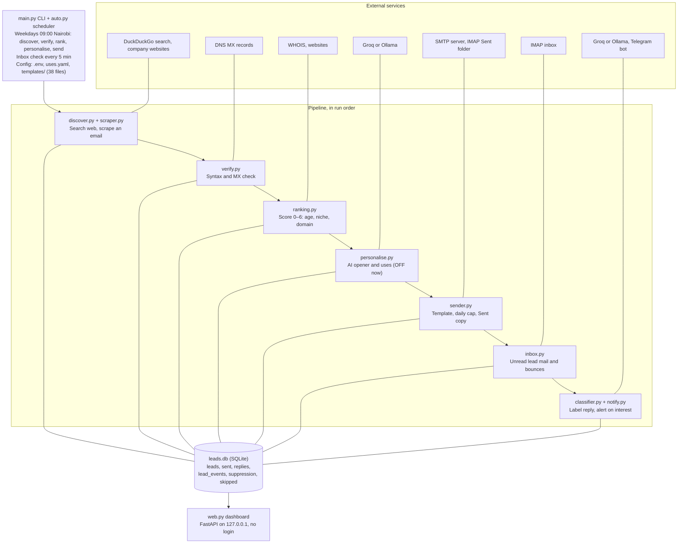
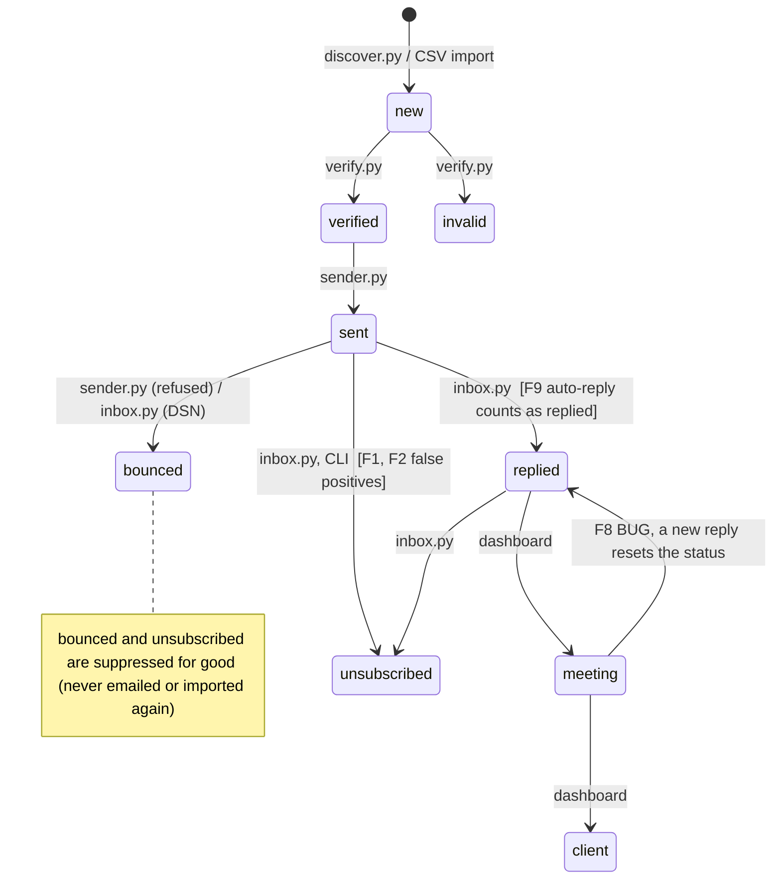
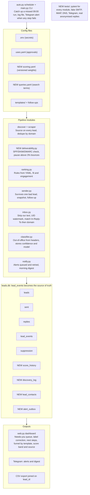

# LeadBot Audit: Current Capabilities, Architecture and Gap Analysis

As of 16 Oct 2026. Exported from the shared audit doc: https://claude.ai/code/artifact/0d258e17-f0f1-41cf-9596-28e1aa38b918

Status: audit only. No code has been changed. Phase 1 starts only after the owner approves it.

## 1. Executive summary

LeadBot works end to end for one operator, but its reply handling can turn interested prospects into permanent unsubscribes. That must be fixed before sending volume rises. Since 11 Oct 2026 it has found 53 leads, sent 41 emails to 39 of them and logged 2 bounces. No human has replied yet.

**What it does today.** It finds Kenyan companies by web search or CSV, scrapes a contact address and checks its domain's MX record. It ranks leads on a 0–6 score and emails up to 25 a day from 38 industry templates, 8 of which are approved. It reads replies from known leads, labels them with regex rules and an LLM, sends interested and question replies to Telegram, and shows everything on a local dashboard. It is about 2,100 lines of Python in 14 modules sharing one SQLite file.

**Most important limitations, all checked against the code:**

1. **Real replies get misfiled.** Run against the real code, "Yes please, call me on Thursday" sent from Outlook and "Interested, send pricing" sent as HTML-only mail were both labelled *unsubscribe*. Our own footer, quoted back in the reply, trips the rule. "Our IT head is on leave, but we would like a demo" was labelled *out_of_office*. None of the three sends an alert, and the first two suppress the lead permanently.
2. **Replies can be missed entirely.** Only unread mail is checked, and replies are matched by sender address only, so a reply read on a phone first, or sent from a colleague's address, is never processed.
3. **One send error stops the day's batch.** Only a refused recipient is caught; any other SMTP or rule error ends the loop.
4. **The data cannot support analysis yet.** Statuses are overwritten in place, and older history is missing: there are no *verified* or *invalid* events, 30 of 41 sent emails have no stored body, and only 5 of 53 leads have a source URL. The classifier's confidence and the time each email was sent are not stored.
5. **Compliance is unconfirmed.** Kenya's Data Protection (General) Regulations 2021 treat marketing email as direct marketing and require a simple opt-out that is honoured absolutely. LeadBot ignores opt-outs sent from a different address, and ODPC registration is still open.

**Recommendation in one line:** fix reply handling, the send loop and data history first (Phase 1, about 7–9 working days). Keep the modular pipeline, suppression list and audit log. Postpone multichannel sequences, CRM sync and AI scoring until there are replies to learn from.

## 2. Verified architecture and lead lifecycle

LeadBot is a modular monolith: 14 small Python modules that never call each other over a network and share state only through one SQLite file, `leads.db`.

Read top to bottom: the scheduler runs the first five stages once each weekday, while the last two run every 5 minutes as replies arrive. personalise.py is built but switched off. The `lead_events` and `suppression` tables are the strongest part of the design: every action is auditable and an opt-out can never be re-imported. Data on 16 Oct 2026: 53 leads, 41 emails sent, 2 replies (both bounces).

### Lead lifecycle

Statuses in `leads.status` as of 16 Oct 2026: 37 sent, 14 invalid, 2 bounced, none further along. F1 and F2: a real reply is misread as an unsubscribe. F8: a later reply undoes *meeting*. F9: an auto-reply counts as *replied*, which would block follow-ups.

## 3. Feature audit

Of 21 capabilities, 5 work as intended, 12 work with limits that matter, 1 is built but off and 3 are missing. Eleven belong in Phase 1. Evidence is the code path or a count from `leads.db` on 16 Oct 2026.

| Capability | Status | Evidence | Limitations | Recommendation | Priority |
| --- | --- | --- | --- | --- | --- |
| CSV import | Working | `scraper.run`; 0 of 53 leads came from CSV | Rows with an email skip the source URL; no dedupe by domain | Record source and URL on every row; reject a known domain | Phase 2 |
| Web discovery | Working | `discover.py`, 36 categories × 8 towns; 52 of 53 leads | 14 of 53 (26%) failed verification; queries are code constants; DuckDuckGo access is unofficial | Log a reject reason per query; move queries to YAML | Phase 2 |
| Email scraping | Working | `scraper.scrape_site`, 6 paths per site | One address kept per company; 5 leads use gmail.com; no named contact | Keep every address found; mark free-mail leads | Phase 2 |
| Verification | Partial | `verify.py`, syntax and MX only | 2 bounces from 40 real leads (5%); no role, disposable or catch-all flag | Pause sending above 3% bounces; add cheap risk flags | Phase 1 |
| Ranking | Partial | `ranking.py`, score 0–6; start year known for 7 leads | Fit only; no outcome feedback; overwritten on every run; scores bunch at 1 and 3 | Score history, reasons shown in dashboard, calibrate after 100 sends | Phase 2 |
| AI personalisation | Off | `USE_AI_OPENER=false`; 0 leads have an opener | Never tested against reply rate | Keep off until a controlled test | Phase 4 |
| Templates and approvals | Working | 38 templates, 8 approved in `uses.yaml` | 19 of 41 emails went to industries not approved today; no template version on a send | Store template name and content hash with each send | Phase 1 |
| Sending | Partial | `sender.run`, cap 25/day, 90 s gap | Batch aborts on any error but a refused recipient; only the date is stored | Catch per lead and continue; store a send timestamp | Phase 1 |
| Follow-ups | Missing | `FOLLOWUPS_APPROVED=false`; no follow-up templates | One touch per lead | One approved follow-up, stopped by any reply | Phase 3 |
| Reply detection | Partial | `inbox.check_once` searches `UNSEEN`, matches From only | Misses replies already read and replies from colleagues; ignores In-Reply-To | UID watermark; match on In-Reply-To, then domain | Phase 1 |
| Reply classification | Partial | `classifier.py`; 3 misfiles reproduced (section 5) | Quoted footer trips rules; confidence and model not stored; no human correction | Strip our own text; store confidence and model; let people correct a label | Phase 1 |
| Alerts | Partial | `notify.py`, Telegram on interested or question | A Telegram error aborts the inbox check after the reply is saved, so the alert is lost for good; job failures alert nobody | Queue alerts with retry; alert on job failure | Phase 1 |
| Opt-out and suppression | Partial | `suppression` table, mailto List-Unsubscribe | Opt-outs from another address are ignored; no one-click unsubscribe | Match opt-outs by thread and domain; log when honoured | Phase 1 |
| Audit history | Partial | `lead_events`: 53 discovered, 41 sent, 2 bounced | No verified or invalid events; a new reply turns *meeting* back into *replied* | Back-fill from `sent`; block status regressions | Phase 1 |
| Pipeline management | Partial | Dashboard sets *meeting* or *client* | No next step, owner, deal value or notes | Add next action and notes per lead | Phase 3 |
| Dashboard | Working | `web.py`, `static/index.html`, localhost | No login; duplicate route; label cannot be corrected | Label override; remove dead route | Phase 3 |
| Analytics | Partial | `stats`, `export`, niche table in dashboard | No results by template, score band or source query | Conversion views over the event log | Phase 4 |
| Scheduling and operations | Partial | `auto.py`, print logging | Missed 09:00 is skipped; no log file; no health alert | Catch-up run, log file, failure alert | Phase 1 |
| Automated tests | Missing | No test files | Regex rules unguarded | pytest suite with real anonymised replies | Phase 1 |
| Security and secrets | Partial | `.env` and `*.db` gitignored; dashboard on 127.0.0.1 | `previews.txt` holds rendered lead emails and is not ignored; no git history | Ignore exports and previews; first commit | Phase 1 |
| CRM and integrations | Missing | None | Not needed at 25 emails a day | CSV export is enough for now | Not yet |

### Benchmark against best-in-class platforms

LeadBot's gaps against commercial platforms such as HubSpot Sales Hub and Instantly are in sequencing, reply management and deliverability monitoring. Data volume, LinkedIn steps and AI scoring matter less at 25 emails a day. The standards below come from the vendors' public help pages and from Google's sender rules; there was no access to their internal systems.

| Area | Public best-practice standard | LeadBot today | Capability | For TalkSasa |
| --- | --- | --- | --- | --- |
| Prospecting | Large searchable contact databases | Web search plus scraping, 52 leads | Record which query and source page each lead came from, and its yield | Essential now |
| Prospecting | Bought contact and intent data | None | Paid data feeds | Skip for now |
| Company intelligence | Firmographics and technographics on every account | Industry, start year, website text | Enrichment APIs | Skip for now |
| Qualification | Separate fit and engagement scores, criteria groups, High/Medium/Low bands ([HubSpot](https://knowledge.hubspot.com/scoring/understand-the-lead-scoring-tool)) | One fit score, 3 rules | Fit score with stored reasons and bands; engagement from replies | Essential now |
| Qualification | Score decay and AI-built scores ([HubSpot](https://knowledge.hubspot.com/scoring/understand-the-lead-scoring-tool)) | None | Decay and model-built scores | Later |
| Personalisation | Template variables plus AI-written lines | Industry templates; AI opener built but off | Controlled test of the AI opener | Later |
| Sequences | Multi-step emails and tasks, business-day delays, auto-unenroll on reply or booked meeting ([HubSpot](https://knowledge.hubspot.com/sequences/create-and-edit-sequences)) | One email per lead | One or two follow-ups that stop on any reply | Essential now |
| Reply management | Replies tied to the thread; enrolment stops automatically ([HubSpot](https://knowledge.hubspot.com/sequences/create-and-edit-sequences)) | Matched by sender only; labels can't be corrected | Thread matching, label correction, a clear "needs you" queue | Essential now |
| Deliverability | SPF or DKIM, PTR, TLS, spam rate under 0.3% for all senders; DMARC, alignment and one-click unsubscribe above 5,000 a day ([Google](https://support.google.com/a/answer/81126)) | Daily cap, 90 s gap, mailto unsubscribe, manual checklist | Automated SPF, DKIM and DMARC check; bounce gate; Postmaster monitoring | Essential now |
| Deliverability | Warm-up networks, many inboxes in rotation, deliverability scoring ([Instantly](https://help.instantly.ai/en/articles/6451970-email-warmup)) | One inbox | Warm-up and inbox rotation | Skip for now |
| Pipeline / CRM | Deals, stages, owners, tasks | Statuses up to *meeting* and *client* | Next step, notes and follow-up date per lead | Essential now |
| Pipeline / CRM | Two-way CRM sync | CSV export | CRM integration | Later |
| Analytics | Step and sequence performance reports ([HubSpot](https://knowledge.hubspot.com/sequences/create-and-edit-sequences)) | Counts, 30-day chart, niche table | Reply and meeting rate by template, industry, score band and source | Essential now |
| Integrations | Calendar booking, Zapier, LinkedIn | None | Calendar and LinkedIn | Skip for now |
| Security | Roles, SSO, audit logs | Local only, no login | Keep it local; add a login before any remote access | Essential now |
| Security | Enterprise permissions and SSO | None | SSO and roles | Skip for now |
| Reliability | Hosted service with monitoring | One foreground process, print logs | Supervised process, failure alerts, daily backup | Essential now |

Kenyan law sets the minimum bar for opt-outs. Under the Data Protection (General) Regulations 2021, marketing email counts as direct marketing. The opt-out must be free and simple, for example a one-word reply or a link in every message, and the right to object is absolute. As of March 2026 the ODPC had not yet issued its section 37 guidelines on commercial use ([Oraro & Company](https://www.oraro.co.ke/?p=76850)). LeadBot already offers a reply-"unsubscribe" opt-out in every email; what is missing is honouring opt-outs that arrive from another address.

## 4. Database and analytics readiness

The schema has the right foundations: stable integer IDs, an event log, a suppression list and copies of what was sent. Still, about half of today's history is missing or overwritten. It can answer "how many did we send and bounce by industry". It cannot answer "which template, score band or source query produces replies". The table compares each requirement with what `leads.db` held on 16 Oct 2026.

| Requirement | Today | Evidence | Fix |
| --- | --- | --- | --- |
| Stable lead ID | Yes: `leads.id`, unique email | 53 leads, no duplicate emails | Keep |
| Company identity | No: one row per email, no company key | 5 leads share gmail.com; CSV import doesn't check domain | Add `company_domain`, unique where not free mail |
| Message threading IDs | Half: our Message-ID is stored, replies keep only the IMAP UID | No `In-Reply-To` or `References` anywhere in the code | Store each reply's Message-ID and In-Reply-To; link the reply to its `sent.id` |
| Consistent timestamps | No: three conventions | `created_at` UTC with no zone; `sent_on` is a UTC date only; `db.sent_today` uses the machine's EAT date; `received_at` is the time LeadBot read the mail, not when it arrived | Store everything as ISO 8601 UTC with `Z`; add `sent.sent_at` and `replies.message_date`; show EAT in the UI |
| Source attribution | Partial | Query on 52 of 53 leads; source URL on only 5 | Make source, query and URL required; add an import batch ID |
| Status history | Partial: status is overwritten, events only since logging began | 41 `status_changed` events, but 0 *verified* or *invalid* events for 53 leads | Back-fill events from `sent` and current status, marked as back-filled |
| Score history | No | `save_scores` overwrites score and reasons for every lead on each run; only `score_version` survives | Copy score and reasons onto the `sent` row at send time; keep a `score_history` table |
| Content sent | Partial | Body stored for 11 of 41 sends; no template version | Store template name, content hash and variant on every send |
| AI decisions | Partial | Label and summary stored; confidence, model and prompt version dropped | Store all three; add a human-corrected label column |
| Schema migrations | Ad hoc | `db.init` adds columns one by one; `web.ensure_schema` adds another | One numbered migration list using `PRAGMA user_version` |

Five rules keep the data analysable without losing history:

1. **Append, don't overwrite.** `lead_events` is the source of truth. A lead's `status` is a cache of its latest event. Every change writes an event first.
2. **Snapshot at the moment of action.** When an email goes out, store the score, reasons, template hash and variant on that `sent` row. Later rule changes then can't rewrite what was true at send time.
3. **One clock.** Store UTC instants. Use the email's own Date header for when it happened and a separate column for when LeadBot processed it.
4. **IDs that survive outside SQLite.** Use the Message-ID for emails, the domain for companies and the integer `id` for leads. Exports keep all three so they can be joined later.
5. **Back-fills are labelled.** Reconstructed rows carry `detail.backfilled = true`, so analysis can include or leave them out.

## 5. Critical workflow and failure-mode findings

Seven failures can lose an interested prospect or a day's sending without anyone noticing. Rows marked *reproduced* came from running LeadBot's own `inbox.text_of` and `classifier.quick_rules` on test messages in a scratch folder, without touching `leads.db`. The rest come from reading the code path named.

| # | Workflow | Scenario → wrong result | How verified | Severity |
| --- | --- | --- | --- | --- |
| F1 | Reply labelling | Outlook reply "Yes please, call me on Thursday" quotes our footer (`just reply "unsubscribe"`) → labelled *unsubscribe*, lead suppressed for good, no alert | Reproduced | High |
| F2 | Reply labelling | HTML-only reply "Interested, send pricing" with our footer in a blockquote → *unsubscribe*. Single-part HTML is also passed to the classifier with its tags still in | Reproduced | High |
| F3 | Reply labelling | "Our IT head is on leave, but we would like a demo" → *out_of_office*, no alert | Reproduced | High |
| F4 | Reply intake | Reply opened on a phone before the 5-minute poll → never fetched, because the search is `UNSEEN` | `inbox.check_once` | High |
| F5 | Reply intake | Reply from a colleague's address → UID written to `skipped`, never looked at again, even if that person is added as a lead later | `inbox.check_once`, `db.add_skipped` | High |
| F6 | Alerts | Telegram times out after the reply is saved → exception ends the inbox check; next poll sees the reply as already seen, so the alert never goes | `inbox.check_once` order: `add_reply` → `set_status` → `notify` with no try | High |
| F7 | Sending | SMTP disconnect or a 4xx/5xx data error on lead 3 of 25 → leads 4–25 not sent that day | `sender.run` catches only `SMTPRecipientsRefused` | High |
| F8 | Pipeline | Lead marked *meeting* replies "see you Thursday" → status reset to *replied* | `db.set_status` has no rule against going backwards | Medium |
| F9 | Follow-ups | Out-of-office auto-reply sets status *replied* → lead would be excluded from follow-ups, which go only to *sent* | `inbox` status map, DASHBOARD.md | Medium |
| F10 | Scheduling | `auto` restarted at 09:10 or the laptop asleep at 09:00 → that weekday's run is skipped silently | `auto.daily_due` requires hour == 9 | Medium |
| F11 | Bounces | DSN from a sender other than mailer-daemon@ or postmaster@ → skipped; dead address stays *sent* | `inbox.BOUNCE_SENDERS` | Medium |
| F12 | Daily cap | Sending between 00:00 and 03:00 EAT stores the previous UTC date → those sends are not counted against today's cap | `sent.sent_on` default vs `db.sent_today` | Low |
| F13 | Dry run | `send --dry-run` still runs `ranking.fill_years` and, with AI on, `personalise.run`, writing to the database and calling the AI | `sender.run` | Low |

Two rules work as intended: a plain Gmail reply with "On … wrote:" quoting is handled correctly, and a polite decline ("I'd rather not hear from you") goes to the LLM rather than tripping a rule.

## 6. The five highest-impact improvements

These five, in this order, protect the few replies LeadBot will get and make every later decision measurable.

1. **Reply handling you can trust** (F1–F6). Remove our own quoted text before any rule runs. Track replies by IMAP UID watermark, not unread state, and match by In-Reply-To before sender. Queue alerts and retry them. *Why:* a reply is the only output that earns money. Today there are at least six ways to lose one, and three of them were reproduced.
2. **History that is never overwritten** (section 4). Make events the source of truth, snapshot score and template on every send, use UTC throughout and back-fill missing events. *Why:* every week of sending without this is a week of results that can never be analysed.
3. **A send loop and scheduler that fail safely** (F7, F10). Handle errors per lead, catch up a missed daily run, log to a file and alert on failure. *Why:* a silent failure costs a full day's quota with no sign that anything went wrong.
4. **Deliverability and opt-out guardrails** (gaps in sections 3 and 5). Check SPF, DKIM and DMARC at start-up, pause above a 3% bounce rate, honour opt-outs from any address in the thread, and add one-click unsubscribe. *Why:* at 5% bounces the outreach domain is already over its own threshold. Kenyan regulations treat the right to object to direct marketing as absolute.
5. **One follow-up plus outcome reporting.** One approved follow-up after 4–7 business days that stops on any reply, with reply and meeting rates shown by template, industry, score band and source query. *Why:* 0 human replies from 39 companies is too little evidence to judge the templates or the scoring. A second touch and per-segment reporting are the cheapest ways to get that evidence.

## 7. Recommended target architecture

The target keeps LeadBot a single-process Python app on one SQLite file. It adds no new services, queues or hosting. All the changes come from three ideas: the event log is the record, every action stores a snapshot, and every outside call can fail without losing data.

The new files are `deliverability.py`, `scoring.yaml` and `queries.yaml`. The new tables are `score_history`, `discovery_log`, `lead_contacts` and `alert_outbox`. Changes to existing tables: `sent` gains `sent_at` and a score and template snapshot; `replies` gains Message-ID, In-Reply-To and confidence; timestamps are UTC throughout; migrations are numbered via `PRAGMA user_version`; SQLite runs in WAL mode with a busy timeout. Everything else is a change inside an existing module. Postgres, a task queue or a hosted CRM are only worth adding past roughly 500 emails a day or more than one user.

## 8–9. Phased implementation roadmap

Four phases. Each one ends with every test passing and a short review with the owner before the next starts. Phase 1 is about 7–9 working days. Nothing below has been built; it waits for approval of Phase 1. Every task is tested with pytest against a temporary database or a copy of `leads.db`, never the live file, and with fake SMTP, IMAP, DNS and Telegram objects so no real email is sent.

### Phase 1: correctness, data integrity, safety and deliverability

| ID | Task | Depends on | Files | Acceptance criteria | Test |
| --- | --- | --- | --- | --- | --- |
| 1.1 | First git commit; ignore `previews.txt`, backup and test databases | — | `.gitignore` | One commit; `git status` shows no database, export or preview files | `git check-ignore` on each file |
| 1.2 | Test harness with real anonymised fixtures | 1.1 | new `tests/`, `requirements-dev.txt` | `pytest` passes in under 10 s; fixtures cover Outlook, Gmail and HTML-only replies, a DSN bounce, an auto-reply and Swahili | Runs locally on every change |
| 1.3 | Numbered migrations and one shared connection helper (WAL, 5 s busy timeout) | 1.2 | `db.py`, `web.py`, `web_extra.py` | A fresh DB and a copy of today's DB migrate to the same schema; bot and dashboard run together with no "database is locked" | Migrate a copy, compare `PRAGMA table_info`; concurrent-write test |
| 1.4 | UTC timestamps; add `sent.sent_at` and `replies.message_date` | 1.3 | `db.py`, `sender.py`, `inbox.py`, `web.py` | New rows are ISO 8601 with `Z`; the daily cap counts the Nairobi day from `sent_at` (fixes F12) | Frozen clock at 01:00 EAT |
| 1.5 | Snapshot on every send: score, reasons, template name and hash, variant | 1.3 | `db.py`, `sender.py`, `ranking.py` | Every new `sent` row has a non-null snapshot; changing scoring later leaves it unchanged | Send to a fake SMTP, rescore, re-read row |
| 1.6 | Back-fill missing events, flagged `backfilled` | 1.3 | new migration script | Every lead has a *discovered* event and a status event matching its current status; nothing else changes | Run on a copy; compare counts before and after |
| 1.7 | Status transition rules | 1.3 | `db.py`, `inbox.py` | *meeting* and *client* never go back to *replied*; *bounced* and *unsubscribed* are final; an auto-reply leaves status alone (F8, F9) | Table test of every from → to pair |
| 1.8 | Clean reply text before rules: drop our own footer, Outlook header blocks, HTML blockquotes; convert HTML to text | 1.2 | `inbox.py`, `classifier.py` | F1 and F2 fixtures are not labelled *unsubscribe*; a real "please unsubscribe me" still is | Fixtures |
| 1.9 | Out-of-office only from auto-reply headers (`Auto-Submitted`, `X-Autoreply`) or subject | 1.8 | `classifier.py`, `inbox.py` | F3 fixture goes to the LLM; real auto-replies still get *out_of_office* | Fixtures |
| 1.10 | Reply intake by UID watermark; match In-Reply-To → `sent.message_id`, then lead domain; re-check skipped UIDs once | 1.3, 1.4 | `inbox.py`, `db.py` | A reply already read is still processed; a colleague's reply links to the lead; 3 runs in a row process nothing twice (F4, F5) | Fake IMAP class |
| 1.11 | Alert outbox with retry | 1.3 | `notify.py`, `inbox.py`, `db.py` | A Telegram failure doesn't end the check; the alert goes out on the next poll, exactly once (F6) | Mock `requests.post` raising, then succeeding |
| 1.12 | Handle send errors per lead; reconnect SMTP once | 1.2 | `sender.py` | A failure on lead 3 still sends leads 4–25; the error is logged as an event (F7) | Fake SMTP that raises on one address |
| 1.13 | Scheduler catch-up, log file, failure alerts | 1.11 | `auto.py`, `notify.py` | Started at 14:00 on a weekday with no run yet → runs; a FAILED step sends a Telegram alert (F10) | Frozen clock; mocked steps |
| 1.14 | Deliverability gate: SPF, DKIM and DMARC check at start; pause when bounces exceed 3% of the last 50 sends; wider DSN detection | 1.10 | new `deliverability.py`, `sender.py`, `inbox.py`, `main.py` | `python main.py doctor` reports each record; send refuses above threshold; F11 fixture is caught | Fake DNS answers; DSN fixtures |
| 1.15 | Opt-out from any address in the thread suppresses the lead | 1.10 | `inbox.py`, `db.py` | An "unsubscribe" from a colleague, matched by In-Reply-To or domain, suppresses the lead and logs who asked | Fixture |
| 1.16 | Store classifier confidence, model and prompt version; let people correct a label in the dashboard | 1.3 | `classifier.py`, `db.py`, `web.py`, `static/index.html` | New replies have all three; a corrected label drives status and stats | FastAPI TestClient |
| 1.17 | Dry run with no side effects; remove the duplicate route | 1.2 | `sender.py`, `web.py` | DB file hash unchanged after `send --dry-run`; one handler for `/api/leads/{id}/emails` (F13) | Hash before and after; route list |

### Phase 2: lead intelligence and explainable scoring

| ID | Task | Depends on | Files | Acceptance criteria | Test |
| --- | --- | --- | --- | --- | --- |
| 2.1 | Company identity by domain; dedupe across CSV and discovery | 1.3 | `db.py`, `scraper.py`, `discover.py` | No two leads share a company domain, except free-mail domains, which are flagged | Import the same company by CSV and search |
| 2.2 | Required source fields, import batch ID, and a `discovery_log` of every site considered with its reject reason | 1.3 | `discover.py`, `scraper.py`, `db.py` | Every new lead has a source, a query or file, and a URL; each skipped site has a reason | Fake search results and pages |
| 2.3 | Keep every scraped address in `lead_contacts`, flagged generic, personal or free mail | 2.1 | `scraper.py`, `db.py` | The best address is still chosen as today; the others are kept | Fixture HTML pages |
| 2.4 | Scoring rules in `scoring.yaml` with a version; separate fit and engagement scores; High/Medium/Low bands; reasons shown in the dashboard | 1.5 | `ranking.py`, new `scoring.yaml`, `web.py`, `static/index.html` | Editing the YAML bumps the version; every lead shows its points per rule | Unit tests per rule; API test |
| 2.5 | `score_history` table appended on every rescoring | 2.4 | `db.py`, `ranking.py` | Rescoring adds rows and never overwrites old ones | Rescore twice, count rows |
| 2.6 | Discovery queries in YAML; a `discover --report` showing leads, invalid rate and replies per query | 2.2 | `discover.py`, new `queries.yaml`, `main.py` | Report matches hand counts on a test DB | Seeded test DB |

### Phase 3: better outreach, reply handling and pipeline management

| ID | Task | Depends on | Files | Acceptance criteria | Test |
| --- | --- | --- | --- | --- | --- |
| 3.1 | One follow-up per approved industry, sent 4–7 business days later in the same thread, stopped by any reply, bounce or opt-out | 1.7, 1.10, owner's wording approval | `sender.py`, new `templates/followup/`, `uses.yaml`, `config.py` | At most 2 emails per lead; never to *replied*, *meeting*, *client* or suppressed leads; shows as one thread in Gmail and Outlook | Frozen dates; fake SMTP checks `In-Reply-To` |
| 3.2 | "Needs you" queue: unhandled interested, question and needs-review replies, oldest first | 1.16 | `web.py`, `static/index.html` | A reply leaves the queue only when marked handled or relabelled | API test |
| 3.3 | Pipeline fields per lead: next step, due date, notes | 1.3 | `db.py`, `web.py`, `static/index.html` | Each change is logged as an event; overdue steps are highlighted | API test |
| 3.4 | Morning Telegram digest: yesterday's sends, bounces, replies and overdue steps | 1.11, 3.3 | `notify.py`, `auto.py` | One message per weekday at 08:30 EAT, built from the event log | Frozen clock; message snapshot |
| 3.5 | Dashboard login, only if it will be reached from another device | Answer to Q6 | `web.py` | No page or API answers without a session | TestClient without a cookie |

### Phase 4: analytics, experimentation and optimisation

| ID | Task | Depends on | Files | Acceptance criteria | Test |
| --- | --- | --- | --- | --- | --- |
| 4.1 | SQL views for the funnel (sent → delivered → replied → interested → meeting → client) by template version, industry, score band and source query, plus time to reply | 1.4, 1.5, 1.6 | `db.py`, `web.py`, `static/index.html` | Numbers match hand counts on a seeded DB; back-filled rows can be left out | Seeded DB |
| 4.2 | Experiments: random variant assignment at send, stored on the `sent` row; report with sample size and a 90% interval | 4.1 | `sender.py`, `db.py`, `web.py` | Assignment is close to 50/50 over 1,000 simulated sends; the report shows "too early" below 50 per arm | Seeded random simulation |
| 4.3 | Trial the AI opener on half of one approved industry | 4.2, owner's approval | `personalise.py`, `config.py` | Runs until each arm has 50 sends, then stops | Uses 4.2 tests |
| 4.4 | Calibrate score weights once 100+ emails have outcomes | 4.1, 2.4 | `scoring.yaml` | A new version only if a band's reply rate differs; old scores kept | Report review with the owner |
| 4.5 | Classifier accuracy from human corrections | 1.16 | `web.py`, `static/index.html` | Shows agreement rate per label once 20 replies are corrected | Seeded DB |

## 10. Unanswered questions

1. Parts 1–3 and the start of Part 4 of the original brief didn't come through. Do they ask for anything not covered here?
2. What daily volume is the target for the next 3 months? If it is over 50 a day, Phase 1 should plan for a second inbox and warm-up.
3. Has TalkSasa confirmed ODPC registration and the legal basis for B2B outreach, and who signs off on that?
4. Who approves follow-up wording, and is the cap 1 follow-up or 2?
5. 19 of the 41 emails went to industries that are not approved today, such as microfinance, health and college. Was that before the approvals were set, and which industries should be approved next?
6. Will the dashboard be opened from a phone, another computer or by colleagues? If so, task 3.5 moves into Phase 1.
7. Can 10–20 real replies, anonymised, including Outlook and Swahili ones, be shared as test fixtures?
8. Is the sending domain separate from talksasa.co.ke, and is there Google Postmaster Tools access for it?
9. Should LeadBot stay on this WSL laptop, or move to a small always-on server? This decides how 1.13 is supervised.
10. Is it acceptable that reply text goes to Groq, outside Kenya, for labelling, or should classification stay on local Ollama?
11. What result counts as success, for example meetings per month?

## Recommendation

**Build first:** Phase 1, starting with 1.1–1.3 (git, tests, migrations), then the reply fixes 1.8–1.11. Until those land, keep `DAILY_LIMIT` at 25 or lower, check the mailbox by hand each day, and look for "unsubscribe" or "out_of_office" labels that hide real interest.

**Retain:** the single-process modular pipeline, SQLite, the plain-text templates with the `uses.yaml` approval gate, the suppression list, the `lead_events` log, stored copies of sent emails, the regex-then-LLM classifier design, Telegram alerts and the FastAPI dashboard.

**Fix:** reply cleaning and intake, the send loop, alert delivery, timestamps, status regressions, history overwrites, opt-outs from other addresses and bounce monitoring. Each is a contained change to an existing module.

**Don't build yet:** multichannel sequences, LinkedIn steps, CRM sync, paid enrichment or intent data, inbox rotation and warm-up networks, AI-built scores and SSO or roles. Each makes sense only after LeadBot has replies to learn from or more than one user.

## Sources

- Google Workspace, Email sender guidelines: https://support.google.com/a/answer/81126
- HubSpot, Create and edit sequences: https://knowledge.hubspot.com/sequences/create-and-edit-sequences
- HubSpot, Understand the lead scoring tool: https://knowledge.hubspot.com/scoring/understand-the-lead-scoring-tool
- Instantly, Email warmup: https://help.instantly.ai/en/articles/6451970-email-warmup
- Oraro & Company, Beyond the Text of the Law: Adopting Best Practices for Direct Marketing in Kenya: https://www.oraro.co.ke/?p=76850
